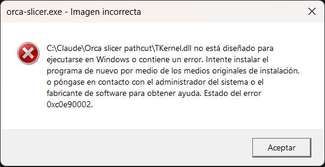

# OrcaSlicer · IMDISIM · Cortar por ruta

> [!WARNING]
> **¿Usas Windows 11?** Puede que al abrirlo salga *«Imagen incorrecta… TKernel.dll… 0xc0e90002»* y no arranque. No es un virus ni un archivo dañado: es una protección de Windows 11 con los programas sin firma digital. **[Aquí te explicamos cómo solucionarlo](#si-no-abre-en-windows-11).** En Windows 10 abre directamente.

**Versión beta Adimaker26** — versión no oficial de [OrcaSlicer](https://github.com/OrcaSlicer/OrcaSlicer) con una herramienta nueva: **cortar figuras por donde tú quieras**, no solo con un plano.

### ⬇️ [Descargar la última versión (Windows 64 bits)](../../releases/latest)

> **¿La has probado?** Cuéntanos si has encontrado algún error y qué te ha parecido en el [**formulario de errores y opinión**](https://forms.gle/iAx6crNoZSRnkDvk7) (abierto hasta el 9 de noviembre de 2026).
>
> **¿Mac o Linux?** Por ahora solo Windows… y una velita a Lourdes para que OrcaSlicer la adopte. 🕯️

---

## Qué hace

- **Ruta desde la vista:** haces clic sobre la figura siguiendo la línea por donde quieres separarla (el pelo, la cintura…). La ruta se suaviza y corta la figura en la dirección en que la estás mirando, o nivelada con la cama, vertical o con el giro que elijas. Puedes limitar hasta dónde llega el corte.
- **Lazo sobre la superficie:** rodeas una parte (un brazo, una pierna) y se separa solo esa parte, con cara de corte plana o curva.
- **Conectores:** espiga y agujero, o pasador suelto; cilíndricos o cuadrados; se colocan solos donde caben, con la holgura que elijas.
- Deja una separación ajustable entre piezas, cierra las caras de corte y coloca la pieza separada en un hueco libre de la placa.

## Cómo instalarlo

1. Entra en [**la última versión**](../../releases/latest) y descarga el archivo que termina en **`_portable.zip`**.
2. Clic derecho → **Extraer todo…** y abre **`orca-slicer.exe`**. No hace falta instalar nada.
3. Windows avisará de que el programa no está firmado: **Más información → Ejecutar de todas formas**. En Windows 11, si sale *«Imagen incorrecta»*, mira [Si no abre en Windows 11](#si-no-abre-en-windows-11).
4. Selecciona una figura y pulsa el icono **Cortar por ruta** de la barra de herramientas.

## Si no abre en Windows 11

Si al abrir `orca-slicer.exe` aparece *«Imagen incorrecta… TKernel.dll no está diseñado para ejecutarse en Windows… 0xc0e90002»*, es **Control inteligente de aplicaciones** (Smart App Control), una protección de Windows 11 que bloquea los programas sin firma digital que Microsoft todavía no conoce. Esta versión es un proyecto pequeño de código abierto y no está firmada. **No es un virus ni un archivo dañado.**

Para poder usarla:

1. Abre el menú **Inicio**, escribe **Seguridad de Windows** y ábrelo.
2. Entra en **Control de aplicaciones y navegador**.
3. Pulsa **Configuración de Control inteligente de aplicaciones**.
4. Elige **Desactivado** y confirma.
5. Vuelve a abrir `orca-slicer.exe`.

**Antes de hacerlo, ten en cuenta:**

- Desactivarlo **reduce la protección** de tu equipo frente a programas desconocidos. Hazlo solo si confías en el origen del programa (el código completo está publicado; ver *Código fuente y licencia*).
- **Poder volver a activarlo depende de tener Windows actualizado.** Desde la actualización de abril de 2026 (KB5083769) se vuelve a activar desde la misma pantalla. En equipos sin esa actualización, desactivarlo es **definitivo** hasta reinstalar Windows: si tienes dudas, actualiza Windows antes.

## Aviso: versión experimental

- Es una **beta** para probar. **Guarda tu proyecto antes de cortar** y revisa las piezas antes de una impresión importante.
- Si el objeto tiene **varias partes**, se unen en una sola antes de cortar; sus modificadores y bloqueadores de soporte se quitan (te avisa). No corta objetos con **varias copias** ni con **volúmenes negativos**: te lo dirá en vez de cortar.
- Ejecutable sin firmar, compilado automáticamente en GitHub Actions a partir del código publicado.
- Se distribuye **sin ninguna garantía**, según la licencia AGPL-3.0.

## Cómo se ha hecho

Esta herramienta la ha desarrollado Rubén Palenzuela (IMDISIM) con **Claude**, la IA de Anthropic: yo marqué qué debía hacer y la probé en impresión real; Claude escribió el código. Se ha revisado con auditorías y pruebas automáticas hechas también con IA, pero **no ha pasado revisión de programadores humanos**. Es una versión beta: úsala, rómpela y cuéntame qué falla.

## Contacto

¿Algo falla, o se te ocurre una mejora? Escríbeme:

- LinkedIn: [Rubén Palenzuela · IMDISIM](https://www.linkedin.com/in/rub%C3%A9n-palenzuela-imdisim)
- Correo: [info@imdisim.es](mailto:info@imdisim.es)

Si puedes, cuéntame qué hiciste, qué esperabas y qué pasó (una captura ayuda mucho).

## Código fuente y licencia

- Cada versión publicada incluye un **zip con el código fuente exacto** con el que se compiló.
- Desarrollo: [RPalGar/OrcaSlicer, rama `feature/path-cut`](https://github.com/RPalGar/OrcaSlicer/tree/feature/path-cut). Archivos principales: `src/libslic3r/PathCutGeometry.hpp`, `src/libslic3r/PathCutConnectors.hpp`, `src/slic3r/GUI/Gizmos/GLGizmoPathCut.cpp`.
- Basado en [OrcaSlicer](https://github.com/OrcaSlicer/OrcaSlicer), licencia **AGPL-3.0**; esta versión mantiene la misma licencia.
- **No es una versión oficial de OrcaSlicer** ni está respaldada por su equipo.

---

Presentado en **Adimaker 2026** (Tenerife) · IMDISIM
